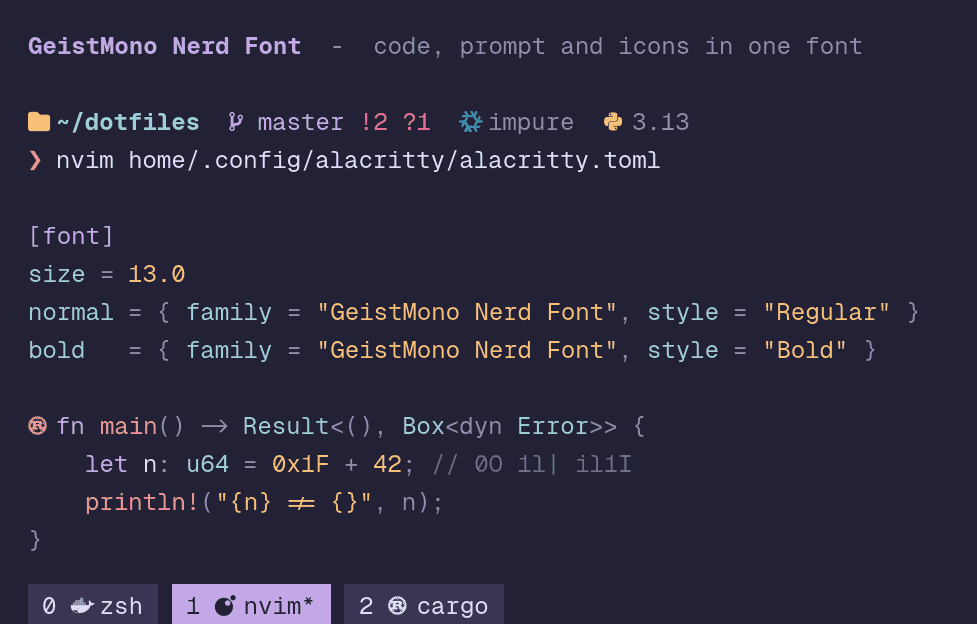
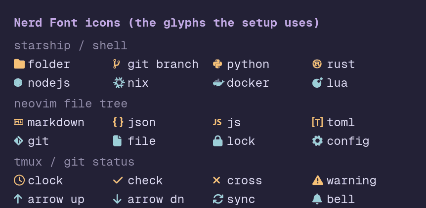
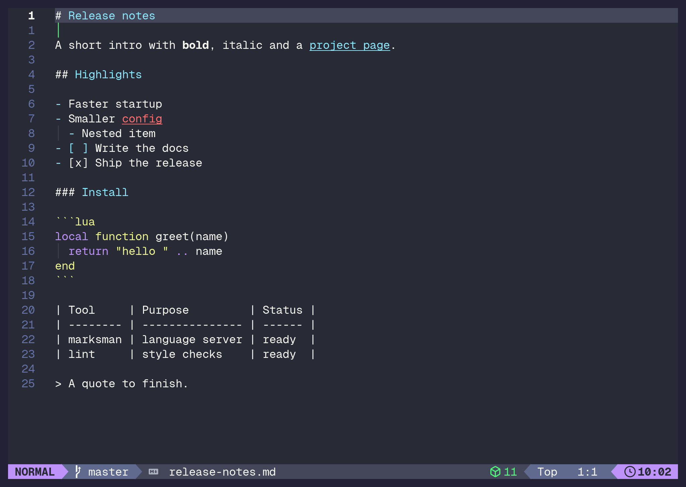
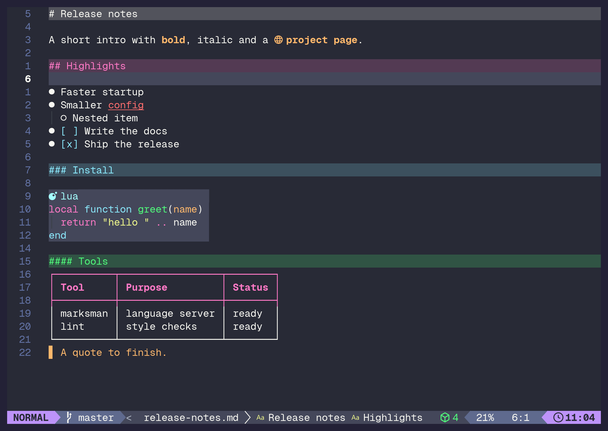

# dotfiles

Personal Linux setup managed with standalone [home-manager](https://nix-community.github.io/home-manager/).
One repo, one command (`make`), and a fresh machine ends up configured the same way every time - on
**Arch Linux** and **Ubuntu**, either native or under **WSL2**.

Based on [kunchenguid/dotfiles](https://github.com/kunchenguid/dotfiles) (the Nix/home-manager
structure) with pieces from [DrMeosch/dotfiles](https://github.com/DrMeosch/dotfiles) (tmux, Alacritty themes).
The original base is a macOS nix-darwin config; this is reworked for Linux as **standalone
home-manager**, which manages your `$HOME` on any distro without needing NixOS.

## What you get

A `home-manager switch` builds:

- **Shell**: zsh with autosuggestions, syntax highlighting, fzf keybindings, and a [starship](https://starship.rs/) prompt (no oh-my-zsh, no powerlevel10k)
- **Multiplexer**: tmux (prefix `C-a`, vi keys) with plugins managed by [tpm](https://github.com/tmux-plugins/tpm), which the config clones and installs on first start (needs `git`)
- **Editor**: [LazyVim](https://www.lazyvim.org/)-based Neovim config (lazy.nvim, neogit, vimwiki, rendered Markdown, devcontainer LSP, neovide settings)
- **Terminal**: Alacritty with a few hand-converted color themes plus the whole [alacritty-theme](https://github.com/alacritty/alacritty-theme) collection (rose-pine moon by default) - desktop targets only
- **CLI tools**: ripgrep, fd, fzf, jq, lazygit, git, rustup, tree-sitter, node, marksman
- **Agent configs**: one shared `AGENTS.md` for Claude / Codex / opencode, plus Claude and Pi settings
- **Font**: [Geist Mono Nerd Font](https://github.com/ryanoasis/nerd-fonts) (family `GeistMono Nerd Font`; Nix on the desktop targets, `windows/setup.ps1` for Windows Terminal on WSL2)
- **Windows host** (WSL2 machines): the flake also renders the Windows-side files - a WinGet configuration (win32yank), a Windows Terminal color scheme and profile, and a `.wslconfig` - which `windows/setup.ps1` applies; see [WSL2 on Windows 11](#wsl2-on-windows-11-the-windows-host-too)



## Layout

```
Makefile             # the entry point: `make` (apply), `make update`, `make check`, `make windows`
flake.nix            # homeConfigurations: arch / ubuntu / wsl-arch / wsl-ubuntu, packages.windows (+ the one `user` line)
flake.lock           # pinned nixpkgs and home-manager revisions (bump with `nix flake update`)
bootstrap.sh         # first run (called by make): install Nix, link ~/.dotfiles, first switch
rebuild.sh           # later runs (called by make): home-manager switch
scripts/
  detect-target.sh   # the one place that picks arch / ubuntu / wsl-arch / wsl-ubuntu
home/
  common.nix         # shared: packages, zsh, starship, tmux, agent configs, symlinks
  gui.nix            # desktop-only: Alacritty + fonts (arch, ubuntu)
  arch.nix           # Arch-only tweaks
  ubuntu.nix         # Ubuntu-only tweaks
  wsl.nix            # WSL2 (either distro): no GUI (clipboard bridge notes)
  .config/nvim/      # Neovim config (edited in place)
  .config/alacritty/ # alacritty.toml + our own themes/ (the upstream collection comes from the flake input)
  .tmux.conf         # tmux config (plugins via tpm)
  .tmux/             # tmux themes (dark/light.conf; current-theme.conf is seeded locally)
  AGENTS.md          # shared agent instructions
  .claude/ .pi/      # agent settings
.github/
  workflows/ci.yml   # CI: make + smoke test on Ubuntu, Arch, and Ubuntu on WSL2; Windows-side setup
  scripts/smoke-test.sh
  scripts/test-detect-target.sh
  scripts/test-make-update.sh
windows/
  default.nix        # renders configuration.winget, the Windows Terminal fragment and .wslconfig
  setup.ps1          # Windows side of WSL2: font, winget configure, fragment, .wslconfig
docs/                # preview images
```

Config files are symlinked **out of the Nix store** (`mkOutOfStoreSymlink`), so you can edit
`home/.config/nvim/...`, `home/.tmux.conf`, `home/.config/alacritty/...` in place and the
change takes effect immediately - no rebuild needed. A rebuild is only needed when you change a
`.nix` file (packages, options).

## Prerequisites

- A 64-bit (`x86_64`) Arch or Ubuntu machine, native or under WSL2. For ARM, change `system` in `flake.nix` to `"aarch64-linux"`.
- `git`, `curl` and `make`:
  - Arch: `sudo pacman -S --needed git curl make`
  - Ubuntu: `sudo apt install git curl make`

## Fresh-machine setup

```sh
git clone https://github.com/<you>/dotfiles.git ~/dotfiles
cd ~/dotfiles
make
```

That is the whole setup. `make` (same as `make apply`) works out which of the four setups this is and
whether the machine has been set up before, and says on screen which path it took:

- **First run** (no `nix`, home-manager not yet active for your user, or `~/.dotfiles` not pointing at this repo): runs `bootstrap.sh`.
- **Every later run**: runs `rebuild.sh`.

The four targets are told apart in one place, `scripts/detect-target.sh`: WSL2 from `/proc/version`, the distro
from `ID` in `/etc/os-release`, falling back to the words of `ID_LIKE` so derivatives (EndeavourOS, Manjaro,
Pop!_OS, Linux Mint, ...) count as their parent. Anything else (another distro, macOS) stops with an error.

| Machine | Target |
| --- | --- |
| Native Arch Linux (e.g. a laptop) | `arch` |
| Native Ubuntu | `ubuntu` |
| Arch Linux under WSL2 | `wsl-arch` |
| Ubuntu under WSL2 | `wsl-ubuntu` |

Override the detection with `make TARGET=wsl-ubuntu`. `wsl` still works as an alias for `wsl-ubuntu`, the
only WSL target there was before the split.

### Native Arch Linux (laptop or desktop)

Nothing Arch-specific beyond the prerequisites. Nix comes from the [Determinate installer](https://github.com/DeterminateSystems/nix-installer)
(not from pacman), which sets up a systemd `nix-daemon` service, so:

```sh
sudo pacman -S --needed git curl make
git clone https://github.com/<you>/dotfiles.git ~/dotfiles
cd ~/dotfiles
make
```

The target is detected as `arch` (desktop: Alacritty and the Geist Mono Nerd Font included). It asks before
touching `flake.nix` (see below); `make YES=1` skips the question.

### WSL2 on Windows 11 (the Windows host too)

A WSL2 machine has two halves: the Linux distro (everything above) and the Windows host it runs on, where
the terminal, the font and the clipboard bridge live. Each gets one command:

| Where | Command | What it does |
| --- | --- | --- |
| WSL2 distro | `make` | the distro itself: home-manager, as on any other target |
| WSL2 distro | `make windows` | renders the Windows files with Nix and copies them to `%USERPROFILE%\.dotfiles-windows` |
| Windows (PowerShell) | `powershell -ExecutionPolicy Bypass -File $env:USERPROFILE\.dotfiles-windows\setup.ps1` | applies them (no admin rights unless a WinGet package asks for them) |

`make windows` copies real files rather than linking them: Windows apps cannot follow `/nix/store` symlinks
over the WSL file share. The folder holds what the flake renders (`nix build .#windows`, defined in `windows/default.nix`):

- `configuration.winget` - a [WinGet configuration](https://learn.microsoft.com/windows/package-manager/configuration/) (DSC resources). It installs `win32yank`, Neovim's clipboard bridge on WSL2 (not in nixpkgs for Linux). More packages go here.
- `windows-terminal-fragment.json` - a Windows Terminal [fragment](https://learn.microsoft.com/windows/terminal/json-fragment-extensions): the Rose Pine Moon color scheme (the palette Alacritty uses) and a "WSL (dotfiles)" profile with `GeistMono Nerd Font`.
- `.wslconfig` - WSL2 settings for `%USERPROFILE%\.wslconfig` (memory is given back to Windows when idle, new virtual disks are sparse).
- `setup.ps1` - a copy of `windows/setup.ps1`, so the folder is self-contained.

`setup.ps1` does, in order: copies the fragment to `%LOCALAPPDATA%\Microsoft\Windows Terminal\Fragments\dotfiles\` and `.wslconfig` to
`%USERPROFILE%\.wslconfig` (an existing, different one is kept as `.wslconfig.bak-<timestamp>`); installs the pinned Geist Mono Nerd Font
for your user and loads it into the running session; runs `winget configure test` on `configuration.winget` and `winget configure`
only if something is not in the desired state; and last sets `profiles.defaults.font.face` to `GeistMono Nerd Font` in every Windows
Terminal `settings.json` it finds (stable, preview and unpackaged installs; a profile that sets its own font keeps it, and a legacy
file with no `profiles.defaults` only gets a warning; the file is backed up as `settings.json.bak-<timestamp>` first, and comments in
it are not kept when it is rewritten - the backup has them). A failure in the font install, the winget step or a `settings.json` only
produces a warning and does not stop the steps after it; the script exits non-zero at the end, after everything else was applied.
Every step does nothing when already done, so it is safe to run again. `-Source <folder>` points it at another folder with the rendered files.

**On a fresh machine**, in this order:

1. **Windows**: get this repo (`git clone`, or download the zip) and run `powershell -ExecutionPolicy Bypass -File windows\setup.ps1`. With no rendered files yet it installs the font and says so.
2. **Windows, manual**: `wsl --install -d Ubuntu` (for Arch, install an Arch WSL distro the way you prefer), restart if asked, and create the first user.
3. **In the distro**: clone the repo, then `make` and `make windows` (Nix is installed on the way).
4. **Windows**: run `$env:USERPROFILE\.dotfiles-windows\setup.ps1` again, as in the table, then `wsl --shutdown` so `.wslconfig` is picked up, and restart Windows Terminal.

After changing `windows/default.nix` (or `windows/setup.ps1`), run `make windows` in WSL and then `setup.ps1` on Windows again.

What stays manual: installing the distro and creating its first user (step 2), and making the profile the default in Windows Terminal
(Settings > Startup > Default profile > "WSL (dotfiles)"; a fragment cannot set `defaultProfile`).

> `winget configure` only installs and configures; it does **not** uninstall what you later drop from `configuration.winget`. Remove such a package yourself (`winget uninstall <id>`).

> After uninstalling a package by hand, `winget configure` may still report it as present for a while; reinstall it with `winget install <id>`.

### What the first run does

Through `bootstrap.sh`, in order:

1. Installs Determinate Nix if `nix` isn't present (flakes enabled). Nix is made available inside that same `make` call, so one command is enough even though your current shell does not have `nix` on `PATH` yet.
2. Symlinks this repo to `~/.dotfiles` (the config resolves edit-in-place paths through it).
3. Checks the `user` in `flake.nix` against your login name and offers to fix it (`make YES=1` accepts without asking, for unattended runs).
4. Runs the first `home-manager switch` for the detected target (existing files are backed up as `*.bak`).

When it finishes, **open a new shell** (or `exec zsh`) so Nix and the new environment are on `PATH`.

Then make zsh your login shell - home-manager installs zsh but cannot change your shell on a non-NixOS distro:

```sh
command -v zsh | sudo tee -a /etc/shells   # register the nix-profile zsh
chsh -s "$(command -v zsh)"                # set it as the login shell
```

Log out and back in (or `exec zsh`) to pick up the new environment.

> If a later run aborts with "would be clobbered by backing it up ... but ... already exists", delete the stale `*.bak` files it names and re-run: home-manager's `-b bak` refuses to overwrite an existing backup.

## Daily use

```sh
make                # edited a file in the repo? re-apply (rebuild.sh)
make update         # git pull --ff-only, then apply
make help           # list the commands
```

`make update` refuses to pull, and says why, when you have local changes to tracked files or your
history has diverged from the remote. The one local change it tolerates is the `user = ` line in
`flake.nix` that the first run may have rewritten; that edit is kept across the pull.

**One-time step for a machine set up before `flake.lock` was committed.** Nix stages the lock it wrote
there (`git add -N`), and the old `make update` refuses to pull over it. Once, run:

```sh
cd ~/.dotfiles
git rm --cached -q flake.lock     # drop Nix's staged lock
mv flake.lock flake.lock.pre-pin  # or delete it
make update
```

`make TARGET=...` and `make YES=1` work with every command.

### Pinned inputs

`flake.lock` pins `nixpkgs` and `home-manager` to exact revisions, so every machine and every CI run
builds the same package versions. To move to newer ones, from the repo:

```sh
nix flake update       # re-resolve both inputs (or: nix flake update nixpkgs)
make check             # evaluate everything against the new pins
git add flake.lock && git commit -m "Update flake inputs"
```

Machines only pull the lock (`make`, `rebuild.sh` and `bootstrap.sh` pass `--no-write-lock-file`); only the
machine that runs `nix flake update` commits it. A locally changed `flake.lock` is kept as
`flake.lock.local-<timestamp>` and the committed one is restored for `make update`.

### What make calls

`make` is a thin layer; the logic stays in the scripts, which you can still run yourself:

```sh
./bootstrap.sh [--yes] [target]   # first run: Nix, ~/.dotfiles link, username, first switch
./rebuild.sh [target]             # home-manager switch for the detected (or given) target
```

### Validate without applying

```sh
make check
```

Runs `nix flake check`, evaluates every homeConfiguration (`arch`, `ubuntu`, `wsl-arch`, `wsl-ubuntu`,
and the `wsl` alias) and builds `packages.windows` (the Windows-side files), without applying anything.

### CI

`.github/workflows/ci.yml` runs the real `make` on every push to `master` and every pull request: a first
`make` that must take the bootstrap path, then a second `make` that must take the rebuild path, then
`.github/scripts/smoke-test.sh` (tools on `PATH` from the Nix profile, linked files resolve into the repo,
tmux loads `~/.tmux.conf` without errors, `nvim --headless +qa` exits 0, a `.md` file outside `~/vimwiki` opens as `markdown` and one inside it as `vimwiki`; on the desktop targets also that `fc-list` / `fc-match` find `GeistMono Nerd Font`). The Ubuntu job also runs
`make help` and `make check`, plus `.github/scripts/test-detect-target.sh`, which checks the four-way
target detection (including WSL2 Arch and Arch/Ubuntu derivatives) against fixture files, and
`.github/scripts/test-make-update.sh`, which drives `make update` against a throwaway origin, and fails if `flake.lock` no longer matches `flake.nix` (a changed input needs a committed lock bump). Jobs: `ubuntu` (ubuntu-latest), `arch`
(archlinux container), `wsl` (Ubuntu 24.04 on real WSL2 on windows-latest, target `wsl-ubuntu`; it also runs `make windows` and checks the
files arrive on the Windows side as real files), `windows-files` (builds `packages.windows` on Linux and uploads it) and `windows`
(downloads those files to `%USERPROFILE%\.dotfiles-windows` on windows-latest, runs `winget configure validate` and `winget configure test`
on `configuration.winget`, runs `windows/setup.ps1` twice (and once more with an unparseable `settings.json`, which must not block the rest), and checks the installed font files and their registration, the edited Windows Terminal settings,
that win32yank is installed, and that the fragment and `.wslconfig` are in place). Arch under WSL2 is not run
on a real WSL2 Arch distro in CI; its detection is covered by the fixture test and its configuration by
`make check`.

Every job that runs Nix gives it the workflow token for github.com (`NIX_CONFIG` with `access-tokens`):
Nix fetches the flake inputs through `api.github.com`, and without a token the shared runners hit its
rate limit (HTTP 403).

## Make it yours

- **Username**: `make` offers to set it on the first run, or change the single `user = "ag"` line in `flake.nix`. Everything (home directory, symlink paths) threads from it.
- **CPU architecture**: `system` in `flake.nix` (`x86_64-linux` by default; `aarch64-linux` for ARM).
- **Default terminal theme**: change the `general.import` line in `home/.config/alacritty/alacritty.toml` to any file in `~/.config/alacritty/themes/`: ours from `home/.config/alacritty/themes/` (gruvbox, night-owl, pink-moon, seoul256, ayu-light, firewatch, ...) or any of the upstream themes (`catppuccin_mocha.toml`, `tokyo_night.toml`, ...). The upstream collection is the `alacritty-theme` flake input, pinned in `flake.lock` and linked read-only from the Nix store; `nix flake update alacritty-theme` moves the pin. Where both have a file of the same name (`dracula`, `nord`, `seoul256-light`) ours wins. A new theme file added to the repo gets its link on the next rebuild.

**Git identity** is deliberately not set, so each machine sets its own:

```sh
git config --global user.name "Your Name"
git config --global user.email you@example.com
```

To manage it declaratively instead, add to `home/common.nix` under `programs.git`:

```nix
settings.user.name = "Your Name";
settings.user.email = "you@example.com";
```

## Notes per target

- **Arch / Ubuntu desktop**: import `gui.nix`, so you get Alacritty and the Geist Mono Nerd Font (`nerd-fonts.geist-mono`, registered with fontconfig by home-manager, so it is there before Alacritty starts). `alacritty.toml` already uses the family `GeistMono Nerd Font`; set the same name in any other terminal. The icons the setup relies on (starship, tmux, Neovim file tree) look like this:

  
- **WSL2 (Ubuntu or Arch)**: no local display, so no Alacritty and no fonts from Nix. The text is drawn by **Windows Terminal** with Windows' own fonts, so the Nerd Font icons (starship, tmux, Neovim) show up as boxes until the same font is installed on Windows. `windows/setup.ps1` does that, and installs `win32yank` (Neovim's Windows clipboard bridge, found through Windows interop) and applies the color scheme, profile and `.wslconfig`: see [WSL2 on Windows 11](#wsl2-on-windows-11-the-windows-host-too). tmux copies via `clip.exe` through the tmux-yank plugin (it is on `PATH` whenever Windows interop is enabled - the default). For `wslview` as `$BROWSER`, install `wslu` (Ubuntu: `sudo apt install wslu`; Arch: from the AUR) and uncomment the line in `home/wsl.nix`.

## Rust

`rustup` is installed on every target and owns the toolchain (`cargo`, `rustc`, `rust-analyzer`); `~/.cargo/bin` is on `PATH` for `cargo install`ed binaries. Neovim uses LazyVim's Rust extra, which picks up `rust-analyzer` from `PATH` (Mason only installs the `codelldb` debugger). First-time setup after a switch:

```sh
rustup default stable
rustup component add rust-analyzer
```

Projects can pin their own toolchain with a `rust-toolchain.toml`.

## Markdown

Markdown files are made for reading in Neovim:

- vimwiki is limited to its own wiki (`~/vimwiki`, `vim.g.vimwiki_global_ext = 0`). Every other `.md` file opens with the `markdown` filetype, so [render-markdown.nvim](https://github.com/MeanderingProgrammer/render-markdown.nvim) and LazyVim's Markdown settings apply to it. Files under `~/vimwiki` keep the `vimwiki` filetype.
- LazyVim's Markdown extra is on: browser preview (`<leader>cp`), the render toggle (`<leader>um`), markdownlint diagnostics and the marksman language server.
- The rendered view stays on in every mode (`render_modes = true`; the line under the cursor shows its raw text) and every heading level gets a full-width background, a tint of that heading's own colour so it fits the active colour scheme. The options live in `lua/plugins/markdown.lua`.

| Before: vimwiki owns every .md file | After: rendered Markdown |
| --- | --- |
|  |  |

The tools come from two places. Nix provides `nodejs` and `marksman` (a .NET binary, so it does not go through Mason). Mason installs `markdownlint-cli2` and `markdown-toc` with npm on the first start. The preview app is built with `npm install` when lazy.nvim installs or updates `markdown-preview.nvim`.

**Browser preview on WSL2**: `:MarkdownPreview` (or `<leader>cp`) starts a small server on `localhost` and prints its address (`Preview page: http://localhost:<port>/page/1`). On WSL2 the plugin opens the page in the Windows default browser through `cmd.exe` (Windows interop, on by default), and WSL2's localhost forwarding lets Windows reach the server. If no browser opens, copy the printed address into the Windows browser. `:MarkdownPreviewStop` stops the server.

## Differences from the source repos

- **Not** nix-darwin - this is standalone home-manager for Linux. No macOS system-defaults layer.
- **WezTerm** (base repo's terminal) is replaced by **Alacritty**; re-adding WezTerm is a few lines in `gui.nix` if you want it.
- **powerlevel10k / oh-my-zsh** (DrMeosch) are intentionally left out in favor of starship + native zsh plugins.
- The DrMeosch security/recon shell functions are **not** included.
- Alacritty themes were converted from the old YAML format to modern TOML.

## License

MIT - see [LICENSE](LICENSE).
